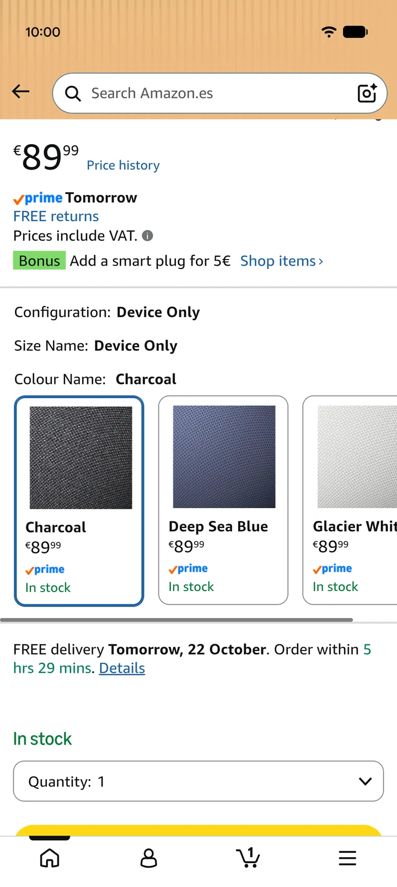
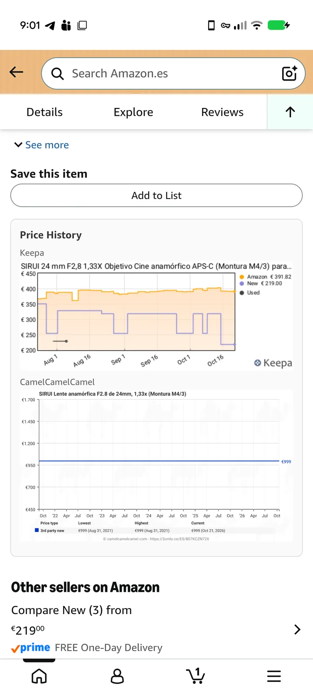
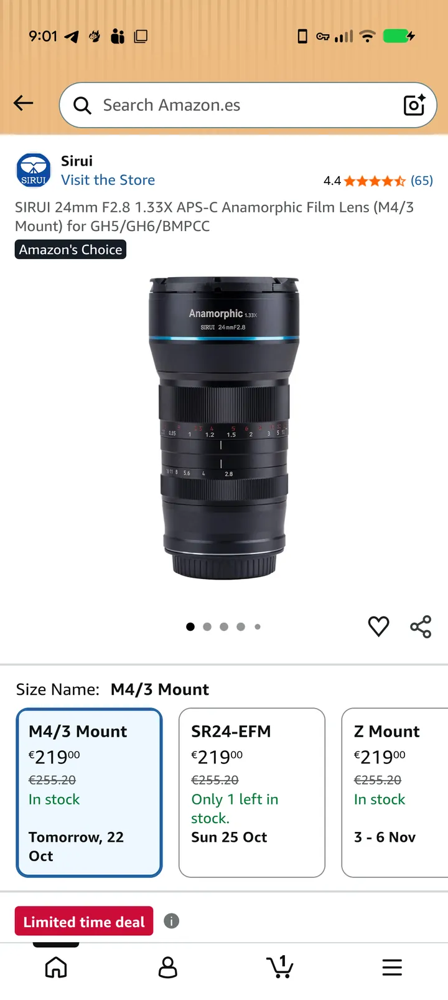
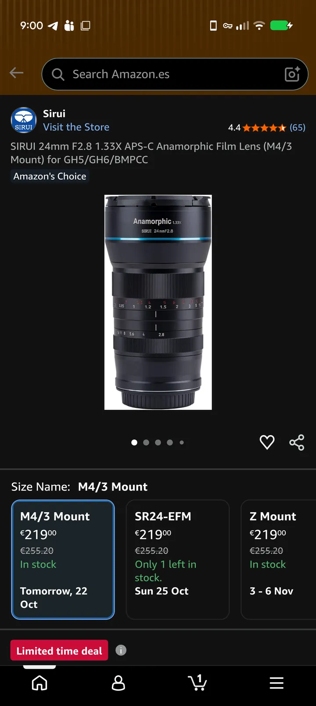
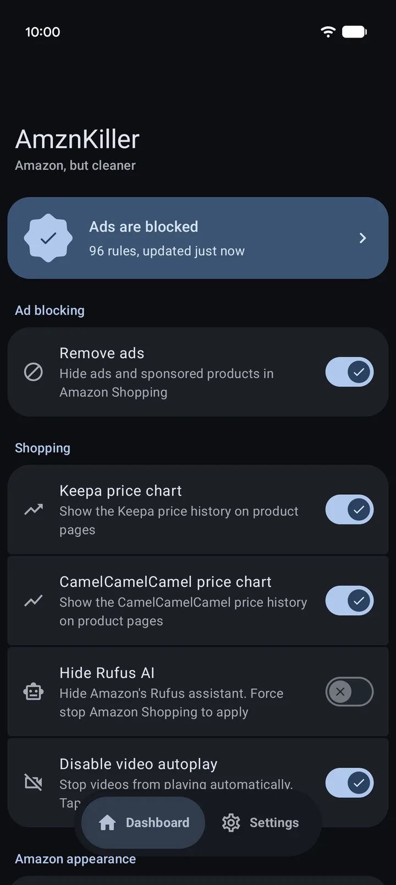
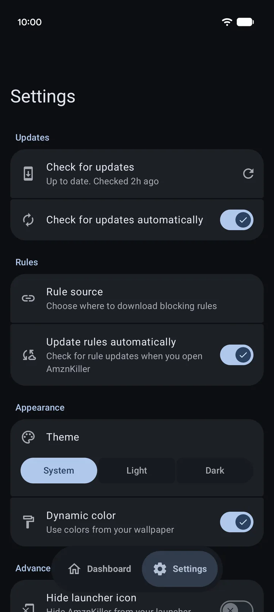
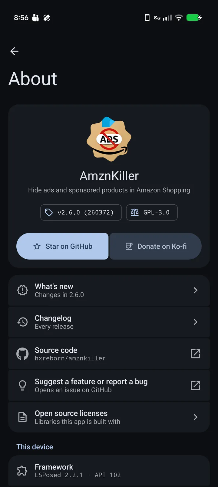
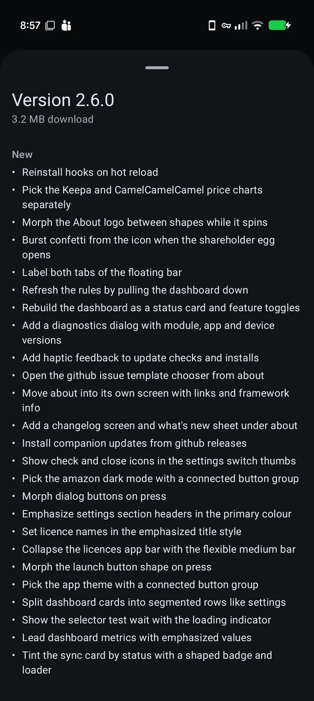

<h1 align="center">
  <picture>
    <source media="(prefers-color-scheme: dark)" srcset="assets/banner_dark.png">
    
  </picture>
</h1>

<p align="center">
  <a href="https://central.sonatype.com/artifact/io.github.libxposed/api"></a>
  <a href="https://github.com/hxreborn/amznkiller/releases/latest"></a>
  <a href="#install"></a>
</p>

An Xposed module that hides ads and sponsored products in the Amazon Shopping app. It injects CSS rules into Amazon's pages that hide the ad markup and leave the rest of the page alone.

- **Remove ads**: hides sponsored results, ad slots and sponsored video carousels.
- **Price history**: adds Keepa and CamelCamelCamel charts to product pages, each with its own switch. Keepa covers Amazon US, UK, DE, FR, JP, CA, IT, ES, IN, MX, BR and AU. CamelCamelCamel covers the same stores except IN, MX and BR.
- **Hide Rufus AI**: removes Amazon's Rufus assistant.
- **Disable video autoplay**: videos wait for a tap.
- **Dark mode**: forces a dark theme on Amazon. Experimental, see [Force dark](#force-dark).
- **Rule updates**: ships with built-in rules and updates them from this repo, or from a list URL you set.
- **App updates**: installs new versions from GitHub releases after checking the checksum and the signing key.

> [!NOTE]
> The blocking is cosmetic. Amazon still sends its ad requests. Pair it with a DNS blocker such as AdGuard, NextDNS or Pi-hole to stop those too.

## Before and after

<div align="center">

<p>Search query: <em>"macbook air m1 16gb 512"</em></p>

<table>
  <tr>
    <th>Stock (2 real results, rest are ads)</th>
    <th>With AmznKiller</th>
  </tr>
  <tr>
    <td></td>
    <td></td>
  </tr>
</table>

<br>

<table>
  <tr>
    <th></th>
    <th>Stock</th>
    <th>With AmznKiller</th>
  </tr>
  <tr>
    <td>Price charts</td>
    <td></td>
    <td></td>
  </tr>
  <tr>
    <td>Dark mode</td>
    <td></td>
    <td></td>
  </tr>
</table>

</div>

<br>

<details>
<summary> Companion app</summary>

<div align="center">

<table>
  <tr>
    <td><br><sub>Dashboard</sub></td>
    <td><br><sub>Settings</sub></td>
    <td><br><sub>About</sub></td>
    <td><br><sub>Update</sub></td>
  </tr>
</table>

</div>

</details>

## Install

Needs Android 10 or newer, root and an Xposed framework with libxposed API 101 or newer (LSPosed or Vector).

1. Download the APK:

    <a href="../../releases"></a>
    <a href="http://apps.obtainium.imranr.dev/redirect.html?r=obtainium://app/%7B%22id%22%3A%22eu.hxreborn.amznkiller%22%2C%22url%22%3A%22https%3A%2F%2Fgithub.com%2Fhxreborn%2Famznkiller%22%2C%22author%22%3A%22rafareborn%22%2C%22name%22%3A%22AmznKiller%22%2C%22additionalSettings%22%3A%22%7B%5C%22includePrereleases%5C%22%3Afalse%7D%22%7D"></a>

2. Enable AmznKiller in your Xposed manager. The scope is fixed to Amazon Shopping (`com.amazon.mShop.android.shopping`), Amazon India (`in.amazon.mShop.android.shopping`) and Amazon Business (`com.amazon.mShop.android.business.shopping`).
3. Force stop Amazon Shopping and open it again.
4. Open AmznKiller. The dashboard says Ads are blocked once the module is active.

Settings apply while Amazon is running, on the next page load: Remove ads, rule updates, Keepa, CamelCamelCamel, video autoplay and WebView debugging. Hide Rufus AI and Dark mode need a force stop of Amazon Shopping.

AmznKiller targets libxposed API 102, so on a framework with hot reload a new version takes effect without restarting Amazon.

## Force dark

Amazon opts out of Android force dark with `forceDarkAllowed=false` in its theme. AmznKiller turns force dark back on for native views and WebViews and adds CSS fixes for the parts it gets wrong.

It needs Android 15 (API 35) or newer. On Android 10 to 14 Amazon's opt-out wins. Some ROMs that aren't Pixel builds don't support it.

Pick Off, System or On under Amazon appearance on the dashboard, then force stop Amazon Shopping.

## Troubleshooting

1. If the dashboard says AmznKiller isn't active, enable the module in your Xposed manager.
2. Force stop Amazon Shopping and open it again.
3. Pull down on the dashboard to update the rules. If the update fails, reset Rule source in Settings to the default.
4. If a page looks broken, turn off Remove ads to check whether the rules cause it.
5. [Open an issue](https://github.com/hxreborn/amznkiller/issues/new/choose) and paste the versions from About > Diagnostics.

## Build

```bash
git clone https://github.com/hxreborn/amznkiller.git
cd amznkiller
./gradlew :app:assembleDebug
```

Requires JDK 21 and the Android SDK. Configure `local.properties`:

```properties
sdk.dir=/path/to/android/sdk

# Optional: release signing
RELEASE_STORE_FILE=<path/to/keystore.jks>
RELEASE_STORE_PASSWORD=<store_password>
RELEASE_KEY_ALIAS=<key_alias>
RELEASE_KEY_PASSWORD=<key_password>
```

See [CONTRIBUTING.md](.github/CONTRIBUTING.md) before opening a pull request.

## License

[](LICENSE)
